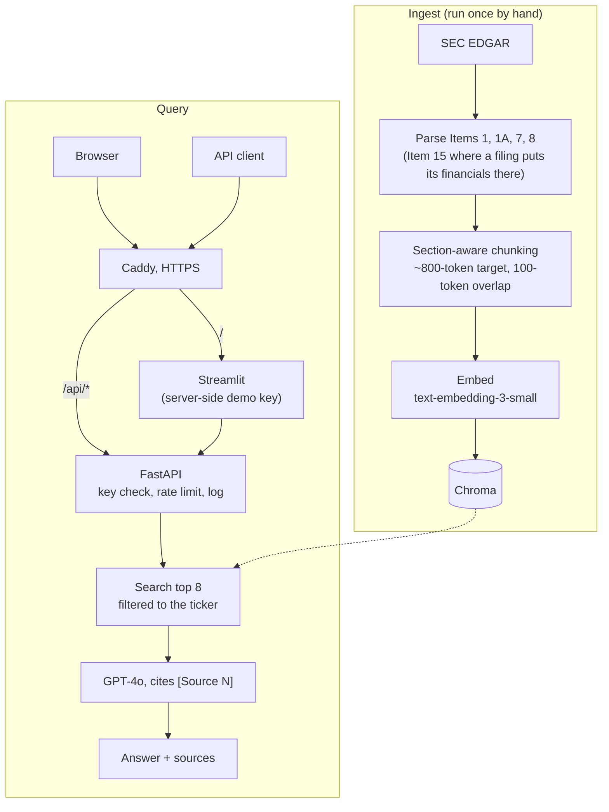

# Conviction

**Live demo: [conviction.irene-nam.com](https://conviction.irene-nam.com)**

Conviction answers questions about SEC 10-K filings with a cited source for every
claim, and refuses when the filing doesn't cover the question. It was built with
credit questions in mind: liquidity, debt, and risk factors. Each answer lists the
filing passages it cites, and a second tab shows what changed in a company's
risk factors (Item 1A) year over year.

## Results

From the official eval run on 2026-10-21, over 4 10-K filings (NVDA, AMD, MSFT,
GOOGL; 416 chunks), retrieving k = 8 chunks filtered to the question's ticker.

| Metric | Result |
|---|---|
| Eval set | 29 questions: 23 answerable, 6 that should be refused; 10 answerable tagged credit |
| Answer-text recall@8 | 12/23 (52.2%) |
| Answer-text recall@8, credit only | 4/10 (40.0%) |
| Chunk-level hit@8 | 9/23 (39.1%) |
| Chunk-level hit@8, credit only | 4/10 (40.0%) |
| Citation precision | 47/58 (81.0%), all 58 citations labeled |
| Abstention accuracy | 6/6 (100.0%) |
| False-refusal rate | 2/23 (8.7%) |

Method: questions were reviewed against the filing and approved by hand,
citations were labeled by hand, and no LLM judge was used. Definitions, the
retrieval misses, and notable failures are in [EVAL_RESULTS.md](EVAL_RESULTS.md).

## How it works



- Chunks never cross an Item boundary, and each carries its ticker, filing date,
  Item and Item title, which is what a `[Source N]` citation points back to.
- The model is told to answer only from the retrieved excerpts and to say so when
  they don't contain the answer; the API returns a `refused` flag with each answer.
- Streamlit doesn't import the pipeline. It calls the API like any other client,
  so auth, limits and logging apply to every request.
- Ingestion and the risk-factor diffs run once at seed time (`scripts/seed.py`);
  the diff tab serves the cached result instead of calling EDGAR per click.

## Security and operations

- **HTTPS** via Caddy, which obtains and renews the Let's Encrypt certificate.
- **API keys stored as SHA-256 hashes.** The plaintext is shown once at creation;
  a leaked database doesn't leak usable keys.
- **Limits:** per-key requests per hour and tokens per day, plus a global daily
  token cap across all keys. Over a limit returns 429 with `Retry-After`.
- **Server-side demo key** for the public page. Streamlit renders on the server,
  so the key never reaches the browser. Visitors can paste their own key instead.
- **One structured JSON log line per request** in CloudWatch, with a request ID,
  stage latencies, token counts and cost. The API key and question text are never
  logged; the question appears only as its length and a short hash.
- **Secrets stay out of git and out of the image:** `.env` is in both
  `.gitignore` and `.dockerignore` and is passed to containers at runtime.
- **OpenAI project budget cap** as the backstop under the app's own limits.

## Use the API

Keys are issued by the operator (see [deploy/RUNBOOK.md](deploy/RUNBOOK.md)).

```bash
curl -s https://conviction.irene-nam.com/api/ask \
  -H "Authorization: Bearer cv_YOUR_KEY" \
  -H "Content-Type: application/json" \
  -d '{"question": "How much long-term debt does AMD have?", "ticker": "AMD"}'
```

The response has `answer` (with `[Source N]` citations), `refused`, and
`sources` (ticker, Item, filing date, chunk ID and text for each source).
`GET /api/tickers` lists the covered tickers; `GET /api/health` needs no key.

## Run it yourself

Both setups need `OPENAI_API_KEY` and `EDGAR_USER_AGENT` in `.env`
(`cp .env.example .env`). Ingestion calls EDGAR and OpenAI.
Run the commands from the repo root.

**Local (venv)**

```bash
python -m venv .venv && source .venv/bin/activate
pip install -r requirements-dev.txt
python -m scripts.ingest_watchlist                 # build the index
python -m scripts.create_key --name me             # prints a key; put it in .env as DEMO_API_KEY
uvicorn src.api.main:app --port 8000 --no-access-log   # terminal 1
streamlit run app.py                               # terminal 2, http://localhost:8501
pytest -q                                          # tests: no network, no OpenAI key needed
```

Streamlit reads `.env` at startup and calls the API at `http://localhost:8000`
by default (set `API_URL` to change it), so add `DEMO_API_KEY` before starting
it, or paste the key into the sidebar instead.

**Docker (compose with the local override)**

Logs go to the console instead of CloudWatch, and Caddy serves plain HTTP on
`http://localhost`.

```bash
docker compose -f docker-compose.yml -f docker-compose.local.yml up --build -d
docker compose -f docker-compose.yml -f docker-compose.local.yml exec app python -m scripts.seed
docker compose -f docker-compose.yml -f docker-compose.local.yml exec api python -m scripts.create_key --name demo
# put the printed key in .env as DEMO_API_KEY, then:
docker compose -f docker-compose.yml -f docker-compose.local.yml up -d --force-recreate app
```

## Design choices

- **One EC2 box with Docker Compose over serverless**, because Chroma and the
  SQLite key and limit store need a persistent disk.
- **Hashed keys:** plain SHA-256 is enough for 32-byte random keys, and lookup
  stays a single indexed query.
- **Fixed-window limits plus a global cap**, with the check and increment in one
  SQLite transaction so simultaneous requests can't both take the last slot.
- **Server-side demo key**, so the public page works without exposing a key.
- **Deliberately not built:** multi-tenancy, an MCP server, and CI (tests run
  locally before each deploy).

## Known limitations

- 4 tickers (NVDA, AMD, MSFT, GOOGL), one 10-K each.
- Tables are flattened to text, so row and column structure is lost.
- Single instance: rate-limit counters live in one SQLite file.
- The eval set is 29 questions, from one run.
- Retrieval is weaker on credit questions (answer-text recall@8 4/10 vs 12/23
  overall); the evidence often sits in one specific note or table that dense
  search misses. Hybrid keyword + vector search is the planned fix.
- Some chunks exceed the ~800-token target: 16 of 416 are over 1,000 tokens.
  This is tracked by an xfail test in `tests/test_chunker.py`.

## Links

- [EVAL_RESULTS.md](EVAL_RESULTS.md)
- [deploy/RUNBOOK.md](deploy/RUNBOOK.md)
